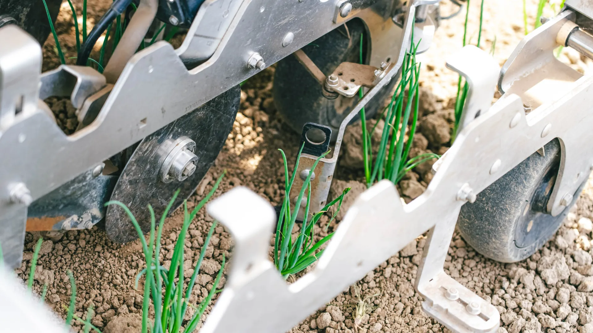
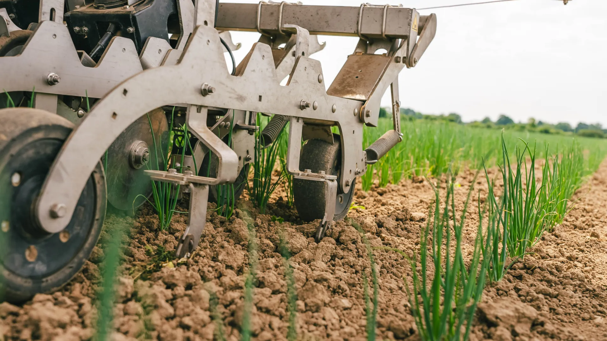
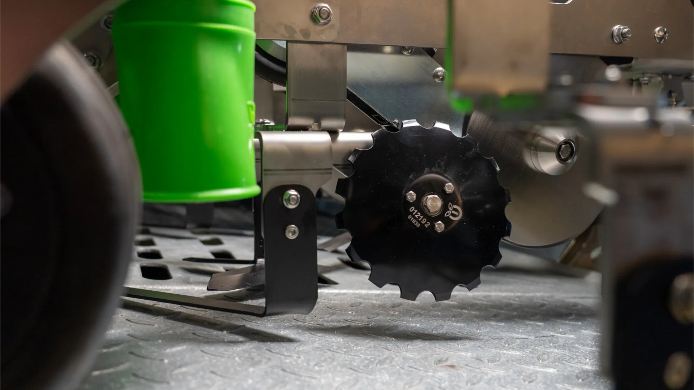
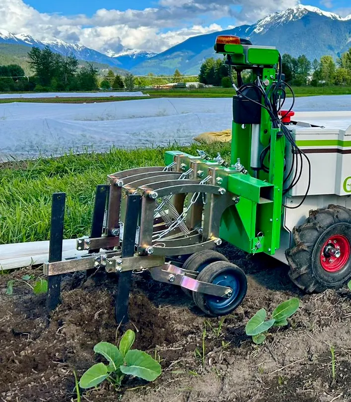
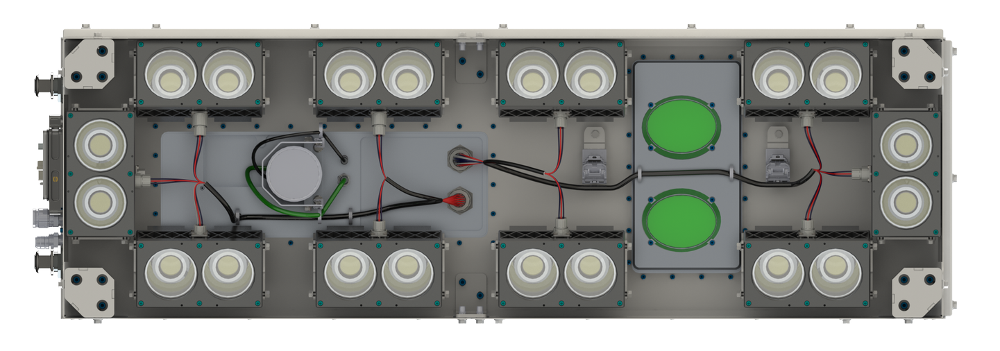

# Agricultural weed-removal robots

This archive follows the conversation in order. It preserves the questions and consolidates the replies, product links, drawings, and pricing findings. Extract the ZIP before opening this Markdown file so the pictures and PDFs resolve locally. Prices are the advertised figures discussed in the conversation and may change.

## 1. Best commercial weed-removal robot and price

**Question:** What is the best agricultural weed-removal robot in the world, and how much does it cost?

For large specialty-crop farms, the pick was the **Carbon Robotics LaserWeeder G2 600**. The reported price was **US$1.4 million plus an annual software and support fee**, confirmed to *Upstream Ag* in 2025. Contact sales for a current quote. The tractor-mounted implement uses 36 cameras and 24 lasers. Carbon rates it at 1.5–3 acres per hour and up to 99% weed kill. It requires a compatible tractor rated at least 145 hp. A Western Growers case study summarized by the University of Arizona found about 40% lower weeding costs at two farms using an earlier LaserWeeder on high-density organic crops. Those field results concern the earlier machine and specific crops.

For a **self-driving robot that also seeds**, the pick was **FarmDroid FD20**, publicly listed by Haggerty AgRobotics at **C$156,488**, subject to add-ons and subscription. It records seed locations by RTK GPS and weeds both within and between rows. Crop type, acreage, and location affect the choice.

Sources: [G2 600](https://carbonrobotics.com/laserweeder-g2-600) · [Reported Carbon price](https://upstreamaginsights.substack.com/p/upstream-ag-professional-february-ac2) · [Field case study summary](https://acis.cals.arizona.edu/agricultural-ipm/vegetables/vipm-archive/western-growers-case-study-carbon-robotics-laserweeder) · [FD20 dealer price](https://www.haggertyagrobotics.com/farmdroid-fd20)

## 2. Manufacturer product URLs

**Question:** Give me the URLs for agricultural weed-removal robots.

| Machine | Method | Manufacturer |
|---|---|---|
| Carbon Robotics LaserWeeder G2 600 | Camera-guided laser weeding on a tractor implement | [Product](https://carbonrobotics.com/laserweeder-g2-600) |
| FarmDroid FD20 | Self-driving solar seeder with GPS-guided mechanical weeding | [Product](https://farmdroid.com/products/farmdroid-fd20/) |
| Naïo Oz | Compact autonomous robot with mechanical implements | [Product](https://www.naio-technologies.com/en/oz-robot/) |
| Aigen Element | Solar-powered autonomous robot with camera-guided mechanical striker, offered in fleets | [Product](https://aigen.io/agriculture) |
| Stout Smart Cultivator | Tractor-drawn machine with vision-guided mechanical blades | [Product](https://www.stoutagtech.com/smart-cultivator/) |
| FarmWise Vulcan | Vision-guided in-row mechanical cultivator | [Manufacturer](https://farmwiselabs.com/) |
| Ecorobotix ARA | Targeted spot spraying | [Manufacturer](https://ecorobotix.com/) |
| Verdant SharpShooter | Targeted spot spraying | [Manufacturer](https://www.verdantrobotics.com/) |

## 3. Videos explaining the mechanical structure

**Question:** Give me video URLs that explain the mechanical structure and design.

| Machine | Video and relevant section |
|---|---|
| Carbon Autonomous LaserWeeder demo model | [Engineering and manufacturing videos](https://carbonrobotics.com/laserweeding-technology). Includes a mechanical engineer's tour and a separate manufacturing video. |
| Carbon LaserWeeder G2 600 | [Official G2 600 field demo](https://www.youtube.com/watch?v=1fOMy7PcSgg) · [Under-machine LaserWeeder walkthrough from 1:31](https://www.youtube.com/watch?v=PpnCu8SUGCU&t=91s). |
| FarmDroid FD20 | [Manufacturer walkthrough](https://www.youtube.com/watch?v=FJGzlmxpRWY), with working width at 2:09, seeding at 4:12 and mechanical weeding at 5:35 · [Tools in action](https://www.youtube.com/watch?v=JDl4hyYBWig). |
| Naïo Oz | [Weeding and hoeing demo](https://www.youtube.com/watch?v=9LdXvkvcSxM) · [Attachment gallery](https://www.naio-technologies.com/en/oz-robot/). |
| FarmWise Vulcan | [Precision cultivator field demo](https://www.youtube.com/watch?v=qDNqx76Ghjk). |

## 4. Mechanical catalogs, PDF documents, and pictures

**Questions:** Give me catalogs and pictures related to the mechanical structure. Give me the PDF documents and pictures.

| Included PDF | What to inspect |
|---|---|
| [FarmDroid FD20 v2.3 spare-parts catalog](files/FarmDroid-parts.pdf) | Front and rear wheel assemblies, drive train, and weeding unit. [Manufacturer source](https://knowledge.farmdroid.io/spare-part-catalog). |
| [FarmDroid FD20 v2.6 English manual](files/FarmDroid-manual.pdf) | Setup and adjustments for the newer revision. [Manufacturer source](https://knowledge.farmdroid.io/fd20v2.6-manual). |
| [FarmDroid illustrated brochure](files/FarmDroid-brochure.pdf) | Page 4 shows the electrically operated knife for between plants and wires for between rows. |
| [Naïo Oz implement catalog](files/Naio-Oz-implements.pdf) | Interchangeable blades, finger weeders, rigid tines, brushes, and harrows. |
| [Carbon Robotics LaserWeeder G2 brochure](files/Carbon-G2-brochure.pdf) | Labeled cameras, lasers, wheel encoder, chiller, electrical cabinet, and under-frame module arrangement. |

See also the [FD20 reassembly guide](https://knowledge.farmdroid.io/overseas_reassembly), [FarmDroid mechanical weeding gallery](https://farmdroid.com/products/mechanical-weeding-system/), and [Naïo Oz tool gallery](https://www.naio-technologies.com/en/oz-robot/).

### Hardware pictures

**FarmDroid FD20 in-row knife.** The powered arm swings the tool into the crop row between plants.

**FarmDroid FD20 wire.** Close-up of a wire tool operating near the soil.

**FarmDroid cutting disc and L-share.** Combined tool shown on the machine.

**Naïo Oz parallelogram-mounted blades.** The linkage carries the tool while allowing vertical movement.

**Carbon G2 laser module underside.** Manufacturer rendering of a sealed laser weeding module.

Additional manufacturer picture: [Naïo Oz Kress finger weeders](https://www.naio-technologies.com/wp-content/uploads/2025/06/oz-outils-doigts-kress_12_11zon.webp).

## 5. Electrical motor-driver design documents

**Question:** Give me electrical motor-driver design documents for the robot.

A public FD20 factory driver schematic, PCB layout, or connector pinout was not verified. The two TI designs are references for a custom robot, and their ratings describe the TI boards.

| Application | Design resources |
|---|---|
| Brushed DC weeding arm | TI TIDA-00620, 12–24 V, 27 A H-bridge with bidirectional PWM, gate drive, current sensing, and startup/stall protection. [Design guide PDF](https://www.ti.com/lit/ug/tiduaw3/tiduaw3.pdf) · [Schematics and design files](https://www.ti.com/tool/TIDA-00620). |
| Three-phase BLDC wheel motor | TI TIDA-00281, 48 V, 1 kW sensorless inverter with current and voltage sensing, fault protection, and isolated CAN. Verify low-speed behavior and loaded starting for the robot. [Design guide PDF](https://www.ti.com/lit/ug/tiduay9/tiduay9.pdf) · [Schematics and design files](https://www.ti.com/tool/TIDA-00281). |

The [FD20 manual function test](https://knowledge.farmdroid.io/manual-function-test_guide) checks full-in and full-out arm travel. The [arm-detection guide](https://knowledge.farmdroid.io/troubleshooting-weeding-arm-not-detected) explains the low motor draw alarm. For selection, match motor type, battery voltage range, continuous and peak current, and any Hall, encoder, or limit-switch interfaces.

## 6. Laser head and mechanical tool integration

**Question:** Give me design docs for the laser heads and other weed-killing tools. Explain how they mount to the robot.

| Reference | Mounting detail |
|---|---|
| [Escarda EP4465815B1](https://patents.google.com/patent/EP4465815B1/en) | Two parallel rails run across the chassis. Sliding shoes guide the module carrier along them for lateral positioning. The patent page provides the drawings as PDF. |
| [Ulan Engine CN119054674B](https://patents.google.com/patent/CN119054674B/en) | Modular head with front bracket, laser tube enclosure, rear bracket, scanning galvanometer, and camera assembly. |
| [Terra Robotics US20260198476A1](https://patents.google.com/patent/US20260198476A1/en) | Figure 1 shows one module. Figure 2 shows multiple heads sharing an implement frame. |
| [Carbon G2 brochure](files/Carbon-G2-brochure.pdf) | The G2 600 uses a Category 3 three-point tractor hitch and twelve sealed modules under the implement. The brochure shows the overall layout. Factory bracket dimensions, bolt pattern, and alignment tolerances were not verified. |
| [Robotized Laser Module research paper (PDF)](https://www.scitepress.org/Papers/2025/137803/137803.pdf) | Figure 5 shows the prototype frame, belt drives, and moving head components in CAD. |
| [FD20 v2.4 weeding adjustments](https://www.manualslib.com/manual/2827055/Farmdroid-Fd20.html?page=44) | Two M6 bolts fasten the knife to the powered swing arm and permit depth adjustment. The wire bracket uses an M8 depth adjustment bolt and two M6 nuts for lateral coverage. |
| [Naïo Oz tool catalog](files/Naio-Oz-implements.pdf) | A parallelogram linkage carries the blades and allows vertical movement while approximately maintaining tool angle. |

The laser mount must preserve camera and head alignment under chassis vibration. A soil-contact mount carries cutting loads and controls tool depth or permits vertical travel.

## 7. FD20 v2.3 components and mounting

**Question:** Give me information and catalogs for components such as reduction gears and wheels.

| Component | OEM part or specification | Catalog reference |
|---|---|---|
| Reduction gearbox | Apex AE155-100-S2-12,7, two-stage 100:1 planetary, 12.7 mm motor shaft | FD20 p. 18 · [Apex AE/AER catalog](https://www.apexdyna.com/download/catalog/AEAER-Eng.pdf) |
| Wheel drive motor | Koford 129H42FD, 400 W, 1,000 rpm, BLDC with Hall sensors | FD20 p. 18 |
| Brake | INTORQ BFK470-06, OEM 35009914, 24 V, 20 W, 4.5 N·m, 10 mm hub bore | FD20 p. 18 · [Kendrion catalog PDF](https://www.kendrion.com/fileadmin/user_upload/Downloads/Brochures_and_Flyers/Industrial_Brakes_INTORQ/brochure-spring-applied-brake-bfk470-2023.04.pdf) · [Mounting instructions PDF](https://www.lenze-selection.com/fileadmin/lenze-selection/documents/en/Operating_Mounting_Instructions/Operating-instruction-spring-applied-brake-BFK470_33001439_EN.pdf) |
| Main tire and rim | ØDI H 588, 6.50×16, 91A6, 6PR, rim 6/161/205. Rear wheels have separate left and right entries. | FD20 pp. 14, 16–17 |
| Hub and bearings | 40 mm hub 101011047, front SS6007-2RS ball bearings and SUCFL205S 25 mm flange bearings | FD20 pp. 14, 16–17 |
| Gearbox brackets | 101012279 left and 101012280 right. Adapter flange 101012281. | FD20 pp. 16–18 |
| Weeding unit | 200×67 mm flex wheels with stainless bearings and 20 mm shaft. NEMA 34 weeding motor 102011043 and 14 mm coupling 102012134. | FD20 p. 33 |

The motor, brake, and reducer are shown together as drive assembly 101011042. The adapter flange joins the motor and reducer. The rear wheel drawings show the drive assembly sitting in side-specific welded frames with gearbox brackets and hubs. For the G2 600, the public specifications detail tractor mounting requirements. A comparable public G2 parts catalog was not verified.

## 8. Component prices and complete powered wheel

**Question:** Give me prices for gears, wheels with reduction gears, and other components.

| Component | Price discussed | Listing or limitation |
|---|---:|---|
| FarmDroid drive unit 101011042R01 | €2,660.40 | [BartsParts](https://bartsparts.com/products/farmdroid-101011042r01/) showed one in stock before tax and shipping. Its title names the Koford motor and brake. Confirm gearbox inclusion because the v2.3 catalog drawing shows R02. |
| Apex AE155 gearbox series | US$2,638 | [E-Motion](https://www.e-motionsupply.com/www_e_motionsupply_com_APEX_gearboxes_AE_Series_p/ae155-xxx.htm) series listing. Confirm exact 100:1 ratio and adapter. |
| Koford motor alone | No verified price | Ask for 129H42FD. |
| INTORQ brake alone | No verified price | [Kendrion BFK470-06](https://www.kendrion.com/en/productfinder/group/product/brakes/bfk470-06). Request the OEM configuration. |
| Comparable 6.50–16 tractor tire | US$149.96 | [SimpleTire](https://simpletire.com/tire-sizes/6.50-16/brands/bkt-tires), tire only. The example is 83A8, while the catalog specifies 91A6. |
| Comparable 16-inch rim | R3,345 before VAT | [Burquip 2025 price list](https://burquip.co.za/wp-content/uploads/2025/06/BQ-PRICE-LIST-2025.pdf), 8.0W×16 with 6/161/205 mounting designation. Confirm width and offset. |
| Stainless wheel bearing | US$6.62–20.83 | [LILY Bearing](https://www.lily-bearing.com/products/s6007-2rs-stainless-steel-bearings/) · [Mädler](https://maedlernorthamerica.com/version/sealed-on-both-sides/page/2/). |
| Comparable 25 mm two-bolt flange bearing | US$77.06–191.22 | [MDS](https://www.mdsofmi.com/product/stainless-steel-2-bolt-flange-sucsfl-205-25mm/) · [Motion](https://www.motion.com/products/sku/07613116). Check housing dimensions. |
| Complete powered rear wheel | No verified public price | Request 101011043 left or 101011044 right. The assembly includes wheel, hub, drive unit, and side-specific mounting hardware. |
| OEM hub, gearbox brackets, weeding-arm motor | No verified public prices | Use the OEM numbers in section 7. |

Confirm the contents of the drive unit before adding a gearbox to the cost. A tire-only price and a drive-unit listing do not establish the price of the full powered wheel.

## 9. Archive request

**Question:** Write all discussions into a Markdown file with pictures, and ZIP all output files.

The original [mechanical references ZIP](files/Weeding-Robot-Mechanical-References.zip) is included, along with its extracted PDFs and pictures for direct use. External videos, product pages, and supplier references are linked above.
